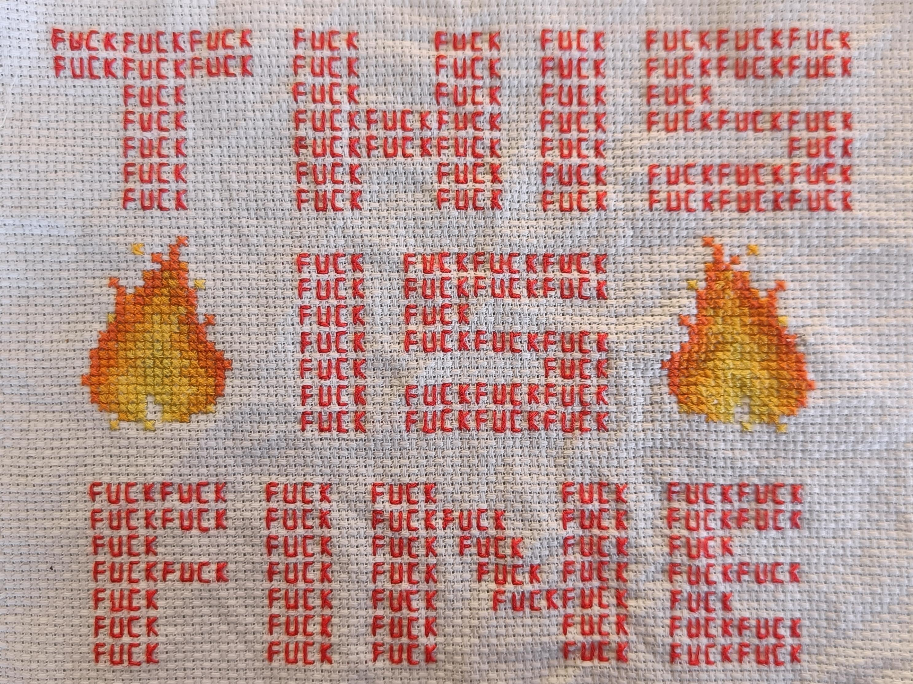

# Capture `*this`

> ## The Evolution of C++ Class Member Lambda Expressions

<div class="abs-br m-6 text-sm opacity-50">
  C++ User Group Aachen
</div>

<!--
Opening slide. Welcome the audience, introduce yourself, show QR codes.
-->

---
layout: two-cols
background: /images/IMG_7352.JPEG
transition: fade-out
---

# What This Talk Covers

How capturing `this` in lambdas evolved across C++ standards

- C++11 — `[this]` captures a pointer
- C++14 — init-capture workaround `[self = *this]`
- C++17 — `[*this]` capture by copy
- C++20 — `[=]` implicit `this` deprecated
- C++23 — `this`? deducing `this`! 
- C++26 — `this` is it. 
  <br>What are deprecations anyway?

<!--
Give a brief roadmap of what we'll cover.
-->

---
src: ./lambda_basics.md
---

---

# Lambda Inside a Struct/Class

````md magic-move {lines: true}
```cpp
#include <iostream>

int main() {
    int i = 42;
    auto print = [=] () { std::cout << "i: " << i << '\n'; };
    print();
}
```

```cpp
#include <iostream>

struct C {
    int i;

    void process() {
        auto print = [] () { std::cout << "i: " << i << '\n'; };
        print();
    }
};  

int main() {
    C c{42};
    c.process();
}
```

<div v-show="$clicks === 0">
<p>Output of program:</p>
<pre><code>i: 42</code></pre>
</div>
````

---

# Lambda Inside a Struct/Class

```cpp
#include <iostream>

struct C {
    int i;
    void process() {
        auto print = [] () { std::cout << "i: " << i << '\n'; };
        print();
    }
};  
```

```
<source>: In lambda function:
<source>:7:52: error: 'this' was not captured for this lambda function
    7 |         auto print = [] () { std::cout << "i: " << i << '\n'; };
      |                                                    ^
<source>:7:52: error: invalid use of non-static data member 'C::i'
<source>:4:9: note: declared here
    4 |     int i;
      |         ^
```

---

# Lambda Inside a Struct/Class: C++11

```cpp
// highlight-word:[&]
#include <iostream>

struct C {
    int i;
    void process() {
        auto print = [&] () { std::cout << "i: " << i << '\n'; };
        print();
    }
};  

int main() { C c{42}; c.process(); }
```

Output

```
i: 42
```

---

# Lambda Inside a Struct/Class: C++11

```cpp
// highlight-word:[=]
#include <iostream>

struct C {
    int i;
    void process() {
        auto print = [=] () { std::cout << "i: " << i << '\n'; };
        print();
    }
};  

int main() { C c{42}; c.process(); }
```

Output

```
i: 42
```

---

# Lambda Inside a Struct/Class: C++11

````md magic-move {lines: true}
```cpp
#include <iostream>

struct C {
    int i;
    void process() {
        auto print = [this] () { std::cout << "i: " << this->i << '\n'; };
        //                                               ^
        //                                               | 
        print();
    }
};
int main() { C c{42}; c.process();   
```

```cpp
#include <iostream>

struct C {
    int i;
    void process() {
        auto print = [this] () { std::cout << "i: " << i << '\n'; };
        //              ^                              ^
        //              |                              |                                                
        print();
    }
};
int main() { C c{42}; c.process();   
```
````

Output

```
i: 42
```

`this` is captured ***by value***, i.e. as ***pointer***. 

---

# C++11

````md magic-move {lines: true}
```cpp
struct C {
    int i;
    void process() {
        auto print = [this] () { std::cout << "i: " << i << '\n'; };
        print();
        ++i;
        print();
    }
};  
int main() { C c{42}; c.process(); }
```

```cpp
struct C {
    int i;
    void process() {
        auto print = [=] () { std::cout << "i: " << i << '\n'; };
        print();
        ++i;
        print();
    }
};  
int main() { C c{42}; c.process(); }
```
````

<div v-show="$clicks === 1">
<p>WTF: <code>this</code> is captured by value (aka pointer), and <code>i</code> is <code>this->i</code>.</p>
<pre><code>i: 42 
i: 43</code></pre>
</div>

---

<div style="height: 100%; display: flex; align-items: center; justify-content: center">
  
</div>

---
background: /images/IMG_9009.JPEG
---

# 3 Years Later ...

---

# How do I capture this by copy?

Idea: use `*this` in capture arguments.

```cpp
// highlight-word:*this
struct C { 
    int i;
    void process() {
        auto print = [*this] () { std::cout << "i: " << i << '\n'; };
        print(); 
    } 
};  
```

---

# C++11: Cannot capture `this` by copy?

```cpp
// highlight-word:*this
struct C { 
    int i;
    void process() {
        auto print = [*this] () { std::cout << "i: " << i << '\n'; };
```

Compiler output for `gcc-6.1 -std=c++11`:

```
<source>: In member function 'void C::process()':
<source>:7:23: error: expected identifier before '*' token
         auto print = [*this] () { std::cout << "i: " << i << '\n'; };
                       ^
<source>: In lambda function:
<source>:7:57: error: 'this' was not captured for this lambda function
         auto print = [*this] () { std::cout << "i: " << i << '\n'; };
                                                         ^
<source>:7:57: error: invalid use of non-static data member 'C::i'
<source>:4:9: note: declared here
     int i;
         ^
Compiler returned: 1
```

---

# C++17: Capture `*this` for a Copy!

````md magic-move {lines: true}
```cpp
#include <iostream>

struct C {
    int i;
    void process() {
        auto print = [*this] () { 
            std::cout << "i: " << i << '\n'; };
        print(); i+=10; /* <- has no effect*/ print();
    }
};  
int main() { C c{42}; c.process(); }
```

```cpp
#include <iostream>

struct C {                   // C++11 feature
    int i;                   //   |          
    void process() {         //   V
        auto print = [*this] () mutable { 
            ++i; std::cout << "i: " << i << '\n'; };
        print(); i+=10; /* <- has no effect*/ print();
    }
};  
int main() { C c{41}; c.process(); }
```
````

Output (when compiled with `gcc-7.5 -std=c++17`):

<div v-show="$clicks === 0">
<pre><code>i: 42
i: 42</code></pre>
</div>

<div v-show="$clicks === 1">
<pre><code>i: 42
i: 43</code> (inner increment has effect!)</pre>
</div>

---
layout: quote
background: /images/DSC_0648.JPG
---

Explicit is better than implicit.

---
background: /images/IMG_9009.JPEG
---

# 3 Years Later ...

---

# C++20: Deprecating Implicit `this` in `[=]`

<div>

The issue is that `this` is captured by value, but the value of `this` is a pointer. So "captured by value" means "captured by value of a pointer" which gives you indirect access to the original object — effectively reference semantics to the object's state.

The trap is not that `[=]` violates its contract — it doesn't. It faithfully captures `this` by value. The trap is that the value of a pointer is an address, so you still mutate the original object through it. People read `[=]` as "I have my own copy of **everything**" but what they actually have is their own copy of a pointer to someone else's data.

That's precisely why C++20 deprecated it — the semantics are technically correct but conceptually misleading.

</div>


---

# C++20: Deprecating Implicit `this` in `[=]`

C++20 deprecated the implicit capture of `this` via `[=]` (P0806R2):

```cpp {all|4,5|6,7|8,9|all}
struct C {
    int i = 42;
    void f() {
        // ⚠️ deprecated: captures this pointer
        auto a = [=]() { return i; }; 
        // ✅ explicit copy of *this (C++17)  
        auto c = [=, *this]() { return i; };  
        // ✅ explicit this pointer (C++20)       
        auto b = [=, this]() { return i; }; 
    }
};
```

<div v-show="$clicks === 1">
<p><b>Why?</b> <code>[=]</code> suggests "everything by value", but <code>this</code> is captured as a **pointer**. This is confusing and error-prone.</p>
</div>

<div v-show="$clicks === 3">
<p><code>[=, this]</code> made valid in C++20 (P0409R2) to provide a clean upgrade path.</p>
</div>

---

# C++20: Deprecating Implicit `this` in `[=]`

Distinguish local variables and class members!

```cpp {2,3,4|5,6|7,8|9,10|4,11,12|13,14|15,16|all}
struct C {
    int i = 42; // class member
    void f() {
        double x = 42.0; // local variable
        // ⚠️ deprecated: captures this pointer
        auto a = [=]() { /* access to copy of */ x; /* ref to member */ ++i;  }; 
        // ✅ explicit copy of *this (C++17)  
        auto c = [=, *this]() { /* access to copy of */ x; return i; };  
        // ✅ explicit this pointer (C++20)       
        auto b = [=, this]() { /* access to copy of */ x;  return i; }; 
        // ✅ explicit copy of *this (C++17)  
        auto d = [*this]() { /* ⚠️ no access to x ⚠️ */ return i; };
        // ✅ local copy of this->i in lamdba 
        auto e = [i = i]() { /* ⚠️ no access to x ⚠️ */ return i; };
        // ✅ reference to this->i 
        auto f = [&i = i]() { /* ⚠️ no access to x ⚠️ */ return i; };
    }
};
```


---

# How to Access `i`

| **Capture** | **What lambda holds** | **`i` refers to** | **`this` captured?** |
|---|---|---|---|
| `[this]` | `C*` (pointer) | `this->i` (original) | Yes |
| `[*this]` | `C` (full copy) | `i` in copy of c | No (copy) |
| `[i = i]` | `int i` (copy of member) | lambda's own `i` | No |
| `[&i = i]` | `int&` (ref to member) | original `this->i` | No |
| `[i]` |  ⛔ | ⛔ | not a local variable |
| `[&i]` | ⛔ | ⛔ | not a local variable |


---
background: /images/IMG_9009.JPEG
---

# 3 Years Later ...
---
transition: none
---

# Recursion

## Regular Function 

```cpp
// In order to understand recursion you must first understand recursion.
int fib(int n) {
    return n <= 1 ? n : fib(n - 1) + fib(n - 2);
};
```

---
transition: none
---

# Recursion With Lambdas

## Regular Function 

```cpp
// In order to understand recursion you must first understand recursion.
int fib(int n) {
    return n <= 1 ? n : fib(n - 1) + fib(n - 2);
};
```

## Lambda? 

```cpp
// In order to understand recursion you must first understand recursion.
auto fib = [](int n) -> int {
    return n <= 1 ? n : fib(n - 1) + fib(n - 2);
};
```

---
transition: none
---

# Recursion With Lambdas

## Lambda? 

```cpp
// In order to understand recursion you must first understand recursion.
auto fib = [](int n) -> int {
    return n <= 1 ? n : fib(n - 1) + fib(n - 2);
};
```

Does not compile

```
<source>: In lambda function:
<source>:4:25: error: use of 'fib' before deduction of 'auto'
     return n <= 1 ? n : fib(n - 1) + fib(n - 2);
                         ^~~
<source>:4:38: error: use of 'fib' before deduction of 'auto'
     return n <= 1 ? n : fib(n - 1) + fib(n - 2);
                                      ^~~
Compiler returned: 1
```

---

# Recursion With Lambdas

```cpp
// highlight-word:std::function<int(int)>
//                             VVVV <--- Did you see [&fib]?!
std::function<int(int)> fib = [&fib](int n) -> int { 
    return n <= 1 ? n : fib(n - 1) + fib(n - 2);
};
```

---
background: /images/IMG_6742.JPEG
---

---
background: /images/IMG_7076.JPEG
---

> # "Remember the Vasa" (Bjarne Stroustrup)


---

# C++23: Deducing `this` (P0847R7)

C++23 introduces **explicit object parameters** — lambdas can now refer to themselves:

```cpp
// highlight-word:this auto self
// C++23: deducing this — no std::function needed
auto fib = [](this auto self, int n) -> int {
    return n <= 1 ? n : self(n - 1) + self(n - 2);
};
```

<v-click>

This doesn't change *capture* rules, but gives lambdas a **first-class `self` reference**.

</v-click>

<v-click>

Also in C++23: **static lambdas** (P1169R4) — `[]() static { ... }` for capture-less lambdas.

</v-click>

<!--
Deducing this is the biggest lambda change since C++11.
It enables recursive lambdas, CRTP-like patterns, and more.
-->

---

# Recursive Lambda Calls Within A Class 

```cpp
// highlight-word:this](this
#include <print>
struct C {    
    int i;
    void process() {
        i = 0; // - this + this is fine!
        auto fib = [this](this auto self, int n) -> int {
            ++i; // count the calls
            return n <= 1 ? n : self(n - 1) + self(n - 2);
        };

        auto r = fib(3);
        std::println("i: {0}, r: {1}", i, r);
    } };
int main() { C c{41}; c.process(); }
```

Output when compiling with `clang-22.1.0 -std=c++23`:

```
i: 5, r: 2
```

---

# Recursive Lambda Calls Within A Class 

Output when compiling with `gcc-15.2 -std=c++23`:

```
// highlight-word:internal compiler error: Segmentation fault
<source>: In lambda function:
<source>:10:15: internal compiler error: Segmentation fault
   10 |             ++i; // count the calls
      |               ^
0x228dd45 diagnostic_context::diagnostic_impl(rich_location*, diagnostic_metadata const*, diagnostic_option_id, char const*, __va_list_tag (*) [1], diagnostic_t)
	???:0
0x229f296 internal_error(char const*, ...)
	???:0
0x8b860a lambda_expr_this_capture(tree_node*, int)
	???:0
[...]
Please submit a full bug report, with preprocessed source (by using -freport-bug).
Please include the complete backtrace with any bug report.
See <https://gcc.gnu.org/bugs/> for instructions.
Compiler returned: 1
```

---
layout: cover
background: /images/IMG_8706.JPEG
---

# My Advice 

---

# Avoid `this` when possible

```cpp
// highlight-word:&i = i
struct C {           // ┌----- `this` is gone
    int i;           // | 
    void process() { // |     ┌-- `this` is unavoidable  
        i = 0;       // V     V   if you insist on lambda for recursion 
        auto fib = [&i = i](this auto self, int n) -> int { /* ... */ }
    // ...        
```

- Any kind of "*You must know what the deduction rules are and these depend on the compiler in use*" will drive you crazy and yields a maintenance hell.
- Interesting: `[&i = i]` builds with `gcc`and `clang`!
- Output when compiling with `clang-22.1.0` or `gcc-15.2 -std=c++23`:
  ```
  i: 5, r: 2
  ```

<!-- Full Code example -->

<!-- #include <print> 

struct C {           // ┌----- `this` is gone
    int i;           // | 
    void process() { // |     ┌-- `this` is unavoidable  
        i = 0;       // V     V   if you insist on lambda for recursion 
        auto fib = [&i = i](this auto self, int n) -> int { 
            ++i; // count the calls
            return n <= 1 ? n : self(n - 1) + self(n - 2);
        };
        auto r = fib(3);
        std::println("i: {0}, r: {1}", i, r);
    }
};
int main() { C c{41}; c.process(); } -->

---
background: /images/IMG_1507.JPEG
---

# Use the Latest and Greatest Compiler 

Or quit. 

Tell management that you do not want to stay in a company that is doomed.  


---
background: /images/IMG_6545.JPEG
layout: two-cols
layoutClass: gap-16
---

::right::

<br>
<br>
<br>
<br>

> # The End

> ## Thank You for choosing C++ 


---


> [Source Code](https://github.com/daixtrose/capture-this) · [Slides Online](#)


Based on [Capture *this in lambda expression: Timeline of change](https://www.nextptr.com/tutorial/ta1430524603/capture-this-in-lambda-expression-timeline-of-change)

<div class="text-sm opacity-50 mt-4">
  C++ User Group Aachen — 2026
</div>


---
layout: two-cols
layoutClass: gap-16
---

# Font Demo

This slide demonstrates the **Atkinson Hyperlegible Next** font — designed for accessibility and legibility.

**Bold text** and *italic text* render clearly. Compare easily confusable characters:

- `Il1|` — uppercase I, lowercase l, digit 1, pipe
- `O0Oo` — uppercase O, digit 0, lowercase o
- `B8` — letter B, digit 8

::right::

# Code Font:<br>Intel One Mono

```cpp
#include <iostream>
#include <vector>
#include <algorithm>

int main() {
    std::vector<int> v{1, 2, 3, 4, 5};

    std::for_each(v.begin(), v.end(),
        [](int& n) { n *= 2; });

    for (auto x : v)
        std::cout << x << ' ';
    // Output: 2 4 6 8 10
}
```
